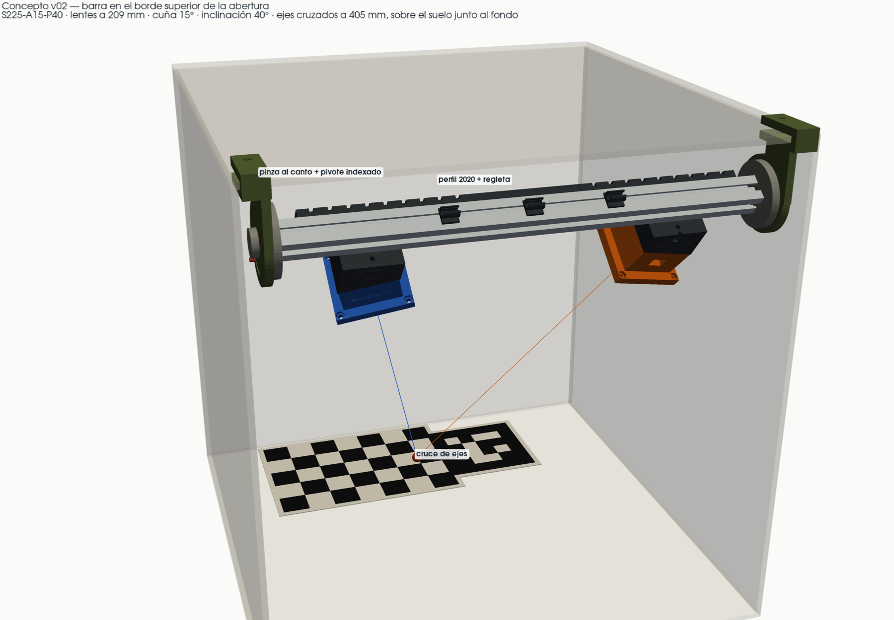
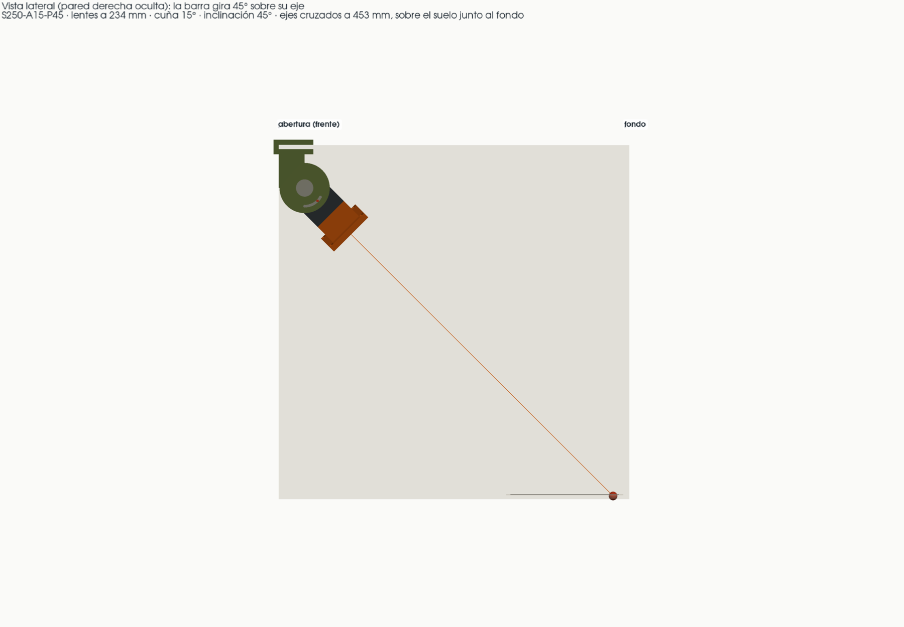
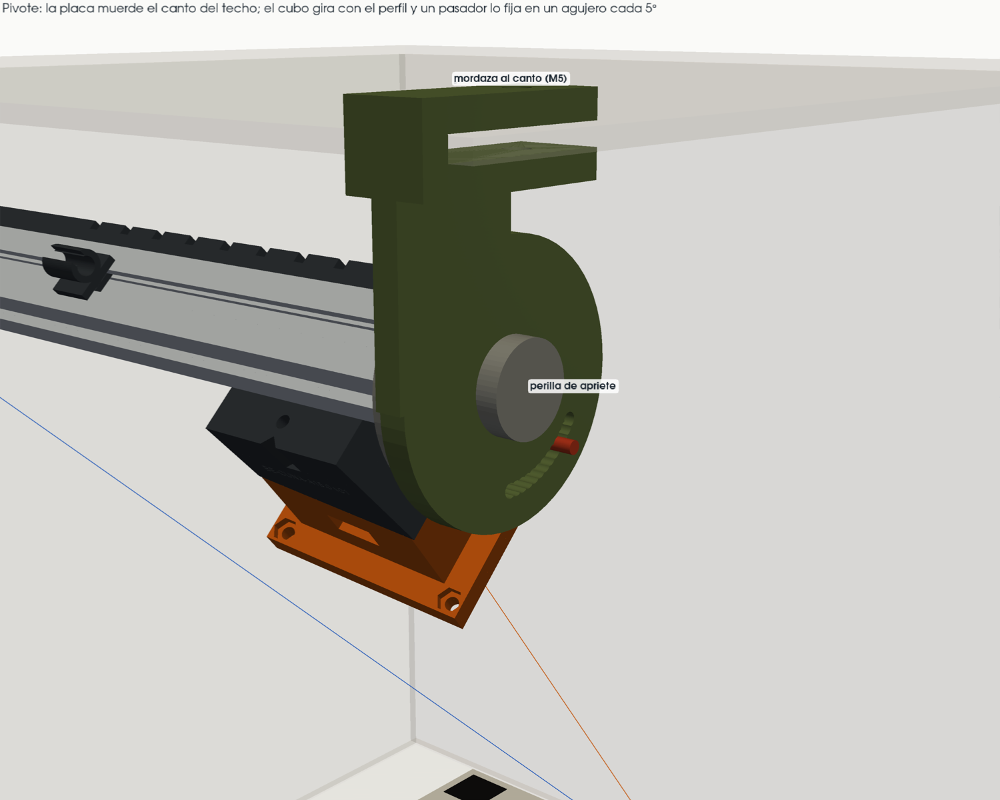
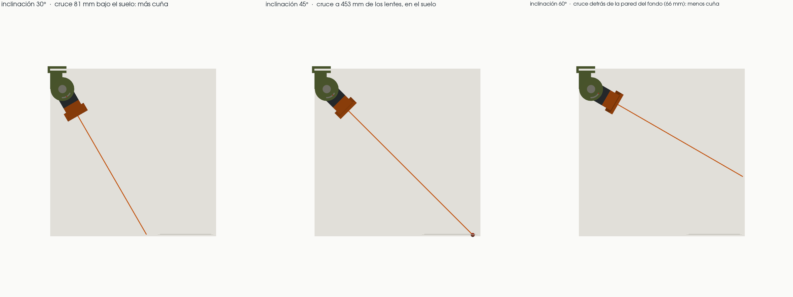
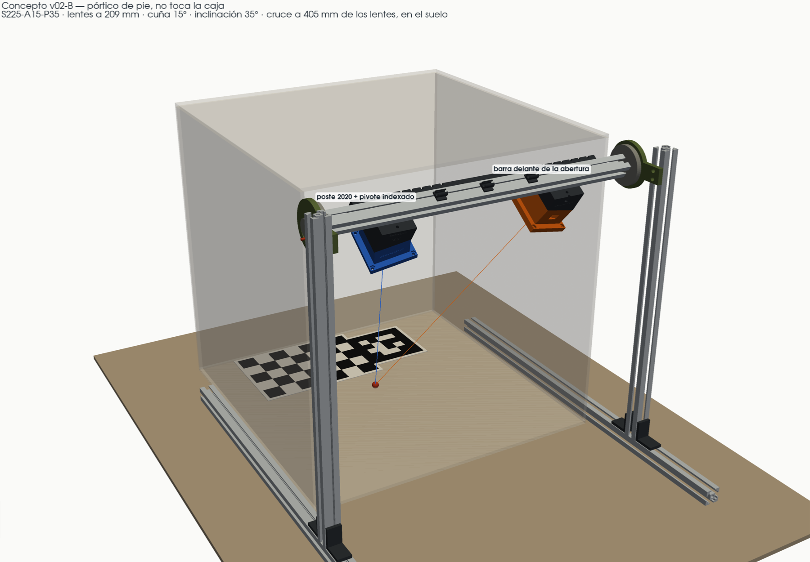
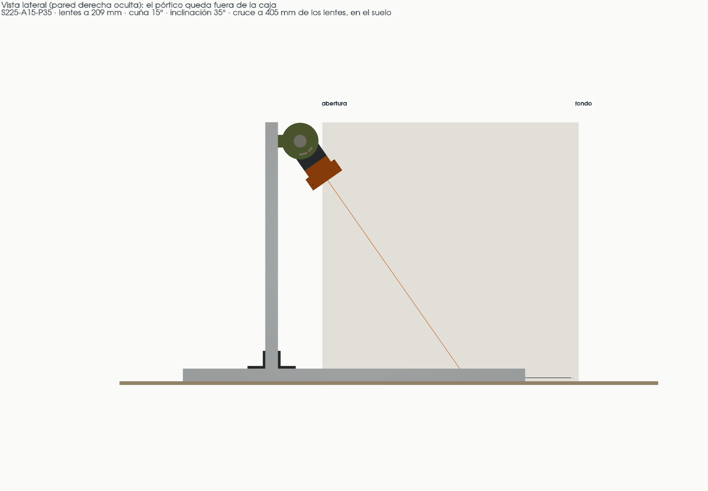

# Meta 004 — Barra en la abertura con inclinación indexada (concepto)

**Estado:** concepto con renders, 2026-11-12. No es una pieza fabricable: es la idea para quien la desarrolle. Sustituye la geometría de la v01 (ADR-002).

## Por qué

**Propósito (del autor).** Sostener dos cámaras USB que miran juntas la misma zona de trabajo, a unos 40 cm. El sistema calcula posiciones en 3D a partir de las dos imágenes, y la precisión depende de que las dos cámaras no se muevan una respecto de la otra mientras se trabaja. Mover la base completa sí está permitido.

La v01 se diseñó con dos supuestos falsos (`docs/CONTEXT.md`, D5 y E1):

1. Las cámaras miraban **en vertical**, con la barra sobre el centro de la caja.
2. La pinza mordía el **borde superior de las paredes laterales**, como si la caja no tuviera techo.

La caja Puluz real (`camarasPosicion.jpeg`, `camarasPosicion2.jpeg`) está **cerrada por cinco lados**: el techo lleva el panel de luz y solo el frente está abierto. Las cámaras se cuelgan del **canto superior de la abertura** y miran **en diagonal**, de arriba al frente hacia abajo al fondo, donde están el tablero ChArUco y Marker0.

## La idea

**Modelos 3D interactivos** (en esta carpeta; se abren con doble clic): `visor.html`, la barra montada en la caja, y `visor-estructura.html`, la estructura sola.



Un perfil 2020 cuelga del canto superior de la abertura, sujeto por una pinza en cada extremo. Cada pinza tiene un **pivote indexado**: el perfil entero gira sobre su propio eje y un pasador lo fija en una posición marcada. Las dos cámaras van montadas en el perfil con las mismas piezas de la v01 (carro, cuña y carcasa), así que **se inclinan juntas** y la geometría entre ellas no cambia.



### Tres ajustes, los tres paramétricos y repetibles (P7)

| Ajuste | Cómo se cambia en la pieza | Rango | Paso |
| --- | --- | --- | --- |
| Separación | Se desliza el carro hasta la muesca de la regleta | 100–300 mm | 25 mm |
| Convergencia | Se cambia la cuña bajo cada carcasa | 0–15° por cámara | 2.5° |
| Inclinación | Se saca el pasador, se gira la barra y se mete en otro agujero; se aprieta la perilla | 0–60° desde la vertical | 5° |



### Qué combinación usar

Los tres ajustes juntos deciden dónde se cruzan los ejes. Con la misma separación y la misma cuña, solo la inclinación mueve el cruce:



| Inclinación | Dónde queda el cruce (S225, cuña 15°) |
| --- | --- |
| 30° | 40 mm bajo el suelo: haría falta más cuña |
| **40°** | **Sobre el suelo, hacia el fondo** (y = 124 mm, z = 5 mm), a 405 mm de los lentes |
| 50° | 62 mm sobre el suelo, cerca de la pared del fondo |

Configuración dibujada: **S225-A15-P40**, elegida para que los ejes se crucen a unos 40 cm, como pide el propósito. Los lentes quedan a 209.5 mm uno del otro y los ejes, a 42.3° de la vertical, se cruzan a 405 mm de los lentes. Todo esto está medido sobre el modelo (`salidas/concepto-abertura/datos.txt`).

## Variante B: pórtico de pie, sin tocar la caja

La misma barra, con el mismo pivote indexado y las mismas cámaras, montada sobre un **pórtico de perfil 2020 que apoya en la mesa**: dos patas de 540 mm por los costados de la caja y dos postes. La barra va entre los postes, 35 mm por delante de la abertura. **Nada toca la caja**: se puede mover la caja o la base completa por separado. El propósito lo permite, porque lo que no puede pasar es que una cámara se mueva respecto a la otra.

Modelo 3D: `visor-pie.html`. Configuración dibujada: **S225-A15-P35**. Los ejes se cruzan en el suelo (z = 1 mm), a 405 mm de los lentes. Medido sobre el modelo, sin choques: las patas quedan a 7.5 mm de las paredes de la caja.





| | A: colgada del canto | B: pórtico de pie |
| --- | --- | --- |
| Sujeción | Pinza al canto del techo | Patas en la mesa; no toca la caja |
| Depende de medir la caja | Sí: grosor y rigidez del canto | No |
| Material extra | Ninguno | 4 perfiles 2020 (2 patas de 540 mm y 2 postes de 390 mm) y 4 escuadras |
| Mover la caja | La barra se mueve con ella | Hay que mover las dos cosas, o alinearlas de nuevo |
| Riesgo de rigidez | La pinza sobre un canto que quizá es blando | Los postes pueden oscilar; la barra une sus extremos y las dos cámaras siguen en la misma pieza |
| Pivote | BE-PINZA-PIVOTE (mordaza) | BE-PIVOTE-POSTE: la misma placa con una oreja atornillada al poste con 2 M5 |

Para dibujar otra configuración: `.venv\Scripts\python.exe -m concepto.pie.render` (≈ 20 s → `salidas/concepto-pie/`). Los parámetros están en `concepto/pie/params.py`.

## Piezas

| Pieza | Estado |
| --- | --- |
| Perfil 2020 | Se acorta a **350 mm** para que quepa entre las paredes con un pivote en cada extremo |
| BE-CARRO, BE-CUNA (×7), BE-CARCASA + tapa, BE-CLIP-CABLE | **Las de la v01, sin cambios.** La carcasa sigue sin tocar el lente (P5) |
| **BE-PINZA-PIVOTE** ×2 (nueva) | Una mordaza en C abraza el canto del techo y se aprieta con un M5. De ella baja una placa con el agujero del eje y 13 agujeros de índice (0–60°, uno cada 5°) |
| **BE-CUBO-PERFIL** ×2 (nueva) | Disco atornillado al extremo del perfil (M5 al agujero central, con un saliente en la ranura para que no gire). Su eje pasa por la placa y lleva un agujero para el pasador |
| Pasador Ø3 + perilla ×2 | El pasador fija el ángulo; la perilla aprieta el cubo contra la placa para quitar el juego |
| BE-REGLETA (spec 002) | Muescas cada 12.5 mm por lado (separaciones de 100 a 300 mm) y punto de referencia en x = 0 |
| BE-PINZA-CAJA (v01) | **Se retira**: no hay borde libre arriba |

## Parámetros

Todos están en `concepto/abertura/params.py`; los que comparte con la v01 los lee de `cad/params.py`. Para dibujar otra configuración se cambian `SEP`, `CONV` o `PITCH` y se corre:

```powershell
.venv\Scripts\python.exe -m concepto.abertura.render   # ≈ 35 s → salidas/concepto-abertura/ (PNG, visor.html, datos.txt)
```

## Lo que quien lo construya tiene que resolver

1. **El canto de la abertura no está medido.** `EDGE_T` usa el 4.5 mm de la v01, que está SIN MEDIR, y hace falta saber si el canto es un marco rígido o tela con varilla. Hay que medirlo antes de imprimir la pinza.
2. **El pivote es la junta crítica de rigidez (P6).** Tiene que cumplir V1 (giro relativo entre cámaras < 0.05°) y, además, que la barra no cabecee bajo carga. Como las dos cámaras están en el mismo perfil, un cabeceo no cambia la calibración entre ellas, pero sí la pose respecto a Marker0. Se mide igual que V1: pose de Marker0 antes y después de tocar la barra.
3. **El espacio a las paredes es justo.** Con el perfil de 350 mm, la pinza llega a x = ±199 mm y las paredes están en ±200. Se gana espacio acortando el perfil o metiendo la placa por dentro del cubo.
4. **El cruce depende de los tres ajustes.** Conviene una tabla (o que `datos.txt` lo diga) con qué cuña usar para cada separación e inclinación. Con la cuña máxima de 15°, separaciones grandes cruzan lejos.
5. **Código de configuración.** El grabado pasa de `S150-A12.5` a algo como `S225-A15-P40`, con la inclinación incluida (P7; formato abierto en B5).

## Criterio de cierre (para la meta que lo desarrolle)

- El modelo tiene 0 mm³ de interferencia con la caja y entre piezas en todo el rango de los tres ajustes.
- En el modelo, cada agujero de índice da su inclinación nominal ± 0.1°.
- Físico: V1 y V2 se cumplen con la barra montada en el canto.

## Lo que no se toca

La carcasa, las cuñas, el carro y los clips de la v01; las holguras de `cad/params.py`; la presentación `salidas/S150-A12.5/` (queda como histórico).
